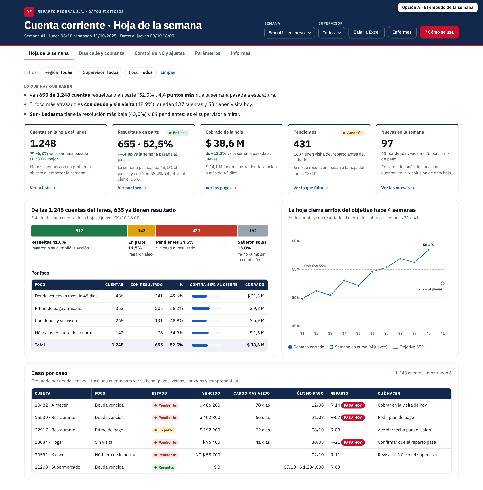
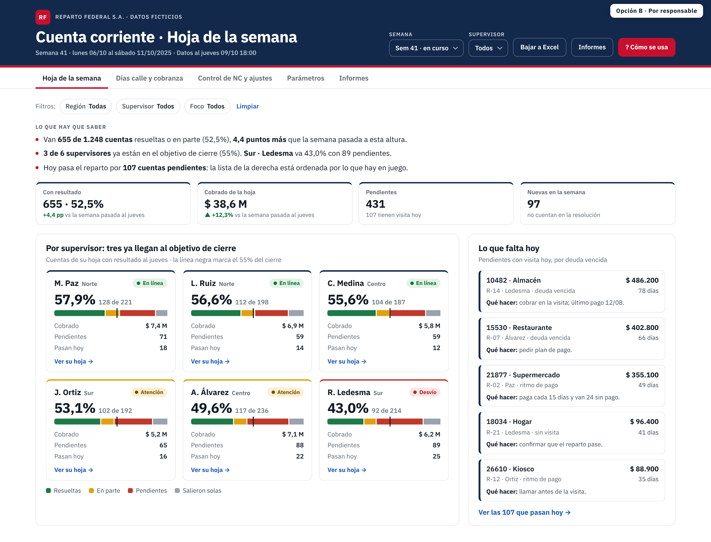

# Caso 02 · Cuenta corriente con hoja de trabajo semanal

Empresa ficticia: **Reparto Federal S.A.**, distribuidora con reparto propio a hogares, comercios y empresas. Tiene 3 sucursales en Córdoba, 6 supervisores, 30 repartos comerciales y unos 2.400 clientes.

**[Abrir el tablero](https://matiasgarnica.github.io/portfolio-control-gestion/caso-02-cuenta-corriente/)** · [Informe para supervisores](https://matiasgarnica.github.io/portfolio-control-gestion/caso-02-cuenta-corriente/04_informes/informe-supervisores_sem41.html) · [Reglas de negocio](reglas-de-negocio.md)

## La pregunta
¿Qué cuentas hay que gestionar esta semana, y qué pasó con cada una?

Antes, cada área miraba un informe distinto: ventas, deuda, pagos, notas de crédito y llamados. La hoja los une. Cada lunes arma una sola lista de cuentas, cada una con un motivo y una acción. Al cierre de la semana mide qué se resolvió.

## Qué muestra
| Pestaña | Para qué sirve |
|---|---|
| **Hoja de la semana** | Cuentas del lunes por foco: deuda vencida, sin visita del reparto, ritmo de pago atrasado o nota de crédito fuera de lo normal. Muestra cuántas tuvieron resultado contra el objetivo, lo cobrado, lo pendiente y lo nuevo. Abre por supervisor, en un mapa y caso por caso, con la ficha de cada cliente: movimientos, gestiones y 12 semanas de venta contra pago. |
| **Días calle y cobranza** | Días de venta sin cobrar, de sucursal a supervisor y a reparto, contra el objetivo. Muestra el mix de cobranza (efectivo contra medios digitales) y el costo de las plataformas. |
| **Control de NC y ajustes** | Notas de crédito desproporcionadas para el cliente, su revisión por administración y los repartos con un patrón de NC e incobrables. |
| **Parámetros** | Los cortes de la hoja (días de vencido, pisos, ritmo, objetivo). Se cambian en vivo y se comparan contra los acordados. |
| **Informes** | Informe para la reunión con supervisores, la lista en CSV, la base completa en Excel y las consultas SQL. |

## Lo que cuentan los datos
- Desde que arrancó la hoja (semana 31), la lista bajó de 344 a 85 cuentas. La resolución pasó de 25% a 52%.
- Los días calle bajaron de 14,5 en julio a 6,4 en septiembre. El objetivo es 6.
- Sur · R. Ledesma concentra la mitad de los pendientes. Sus repartos R-27 y R-28 también aparecen en el control de NC e incobrables.
- Hay 46 notas de crédito fuera de lo normal desde abril. Los motivos cargados parecen normales; lo que las delata es el monto contra lo que el cliente compra.

## Cómo está hecho
| Capa | Archivo |
|---|---|
| Datos ficticios (semilla fija) | `02_codigo/generate_case.py` → `01_datos/*.csv` (modelo estrella: 5 dimensiones, 5 hechos) |
| Reglas | [`reglas-de-negocio.md`](reglas-de-negocio.md): alcance, deuda FIFO, focos, estados, días calle, control de NC |
| SQL Server | [`sql/`](sql/): esquema, hoja semanal (antigüedad FIFO con sumas acumuladas), días calle y control de NC |
| Motor | `02_codigo/build_data.py` (rasgos por cuenta y semana) y `02_codigo/hoja.py` (la hoja con los parámetros acordados) |
| Tablero | `02_codigo/app.js` + `dashboard_template.html` → `03_tableros/cuenta-corriente.html`. Un solo archivo que abre sin internet; la hoja se recalcula en el navegador cuando cambian los parámetros |
| Informe | `02_codigo/build_informe.py` → `04_informes/informe-supervisores_sem41.html` |
| Excel | `02_codigo/build_excel.py` → `01_datos/Base-cuenta-corriente.xlsx`. Trae los datos crudos, los días calle con fórmulas SUMIFS y la hoja de la semana |

**Verificación:** `sql/verificar_sql.py` traduce el T-SQL a DuckDB con sqlglot, lo corre sobre los CSV y lo compara con Python. Las 11 semanas de la hoja coinciden cuenta por cuenta (foco, estado y nuevas), igual que los 300 registros reparto-mes de días calle y los 46 casos de NC. El motor del tablero se comparó con `hoja.py` para las 11 semanas y con un parámetro cambiado. El Excel se recalculó y cuadra con el tablero.

```
python generate_case.py && python build_data.py && python build.py && python build_informe.py && python build_excel.py
python ../sql/verificar_sql.py
```

## Maquetas
Las dos propuestas de pantalla. La A quedó como tablero y la B como informe para supervisores.

| Opción A · El embudo de la semana | Opción B · Por responsable |
|---|---|
|  |  |
